# Evidence: the Zalo download code in soctrungkien/ZaloXposed is taken from SexAlloy

> **Update 2026-11-25:** in commits dated 2026-11-24 the fork replaced its history, deleted the comment naming its source and renumbered the menu IDs `20056` / `20057`. Three of the four download files are still byte-identical, and the fork's published APK still contains the code. See [section 10](#section-10). Sections 1–9 below describe the fork as it was at `23895ba` and are unchanged.

The media download feature in the fork [soctrungkien/ZaloXposed](https://github.com/soctrungkien/ZaloXposed) is a Java port of the Zalo **Download** patch from [gnadgnaoh/SexAlloy](https://github.com/gnadgnaoh/SexAlloy) (package `io.github.nexalloy.revanced.zalo.download`).

The original was committed on GitHub on **25 October 2026**. The fork added its port on **28 October 2026**, three days later.

Every code image is an exact excerpt of the source files with their original line numbers. Nothing is retyped.

## What was compared

| | Repository | Commit | Date (UTC+7) |
|---|---|---|---|
| Original (Kotlin) | gnadgnaoh/SexAlloy | [`53c191d`](https://github.com/gnadgnaoh/SexAlloy/tree/53c191df7edb6cd637330d78297942a6c65f6a41/app/src/main/java/io/github/nexalloy/revanced/zalo/download) | 2026-10-25 07:22 |
| Port (Java) | soctrungkien/ZaloXposed, branch `main` | `23895ba` (old history; current `main` is `aac4900`, see section 10) | 2026-11-01 12:34 |
| **Commit that added the ported download code** | soctrungkien/ZaloXposed | **`9d5b7bf`** | **2026-10-28 13:41** |

In SexAlloy, the six download files were added by commits `19620f9` ("Add download feature to stories and media menu", 07:17) and `af04e0c` ("Add download for Zalo (No Zalo Video)", 07:17), then merged by `53c191d` (pull request #50, 07:22). All three were created on the GitHub website: their committer is `GitHub <noreply@github.com>` and they carry a signature made with key `B5690EEEBB952194`, the key GitHub uses for commits made through its web interface. Their timestamps therefore come from GitHub's servers. The raw commit objects, signatures included, are saved in [`docs/evidence/original-commits/`](docs/evidence/original-commits/).

Five of the six files (`DownloadPatch.kt`, `FeedMedia.kt`, `ZaloModel.kt`, `ZaloSaver.kt`, `ZaloJxl.kt`) are byte-identical between `53c191d` and the current `root` branch. Only `Fingerprints.kt` changed afterwards (see section 9).

All four ported files were added to the fork in one commit by `soctrungkien`: `9d5b7bf`, with the commit message ".".

The upstream project [ElectroHeavenVN/ZaloXposed](https://github.com/ElectroHeavenVN/ZaloXposed) does not contain these files in its `main`, `dev` or `microg` branches (checked 2026-11-12). This evidence concerns the fork only.

## 1. The fork's own source names the origin

The class comment of `hooks/functional/DownloadMediaHook.java`, lines 34–36, says the implementation "is based on the readonly NexAlloy patch and uses the same model-independent reflection strategy". The comment is already present in commit `9d5b7bf`.

Upstream [NexAlloy/NexAlloy](https://github.com/NexAlloy/NexAlloy) has no Zalo code. The only "NexAlloy patch" for Zalo download is the one in SexAlloy, which keeps the `io.github.nexalloy` package name.

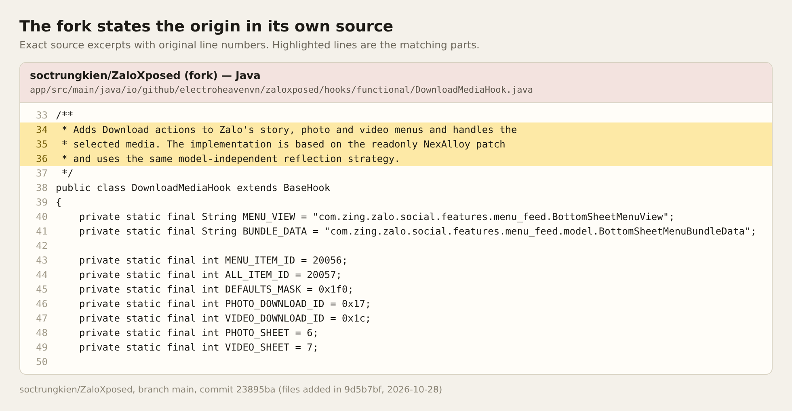

## 2. File-by-file mapping

| SexAlloy (Kotlin) | soctrungkien/ZaloXposed (Java) | What matches |
|---|---|---|
| `DownloadPatch.kt`, `Fingerprints.kt` | `hooks/functional/DownloadMediaHook.java` | Menu IDs `20056` / `20057`, `DEFAULTS_MASK = 0x1f0`, `PHOTO_SHEET = 6`, `VIDEO_SHEET = 7`, the same resource-name constants, the same 10-argument menu-item factory call |
| `FeedMedia.kt` | `utilities/FeedMedia.java` | Class name, the five fields `id, urls, missing, streams, videos`, the five constants, the `walk` / `link` logic, the `"feed_"` prefix |
| `ZaloModel.kt` | `utilities/ZaloModel.java` | Class name, the five helpers `fields`, `valueOfType`, `holdsInt`, `reachable`, `find`, the `java.` / `android.` / `kotlin.` filters, the identity-set depth search |
| `ZaloSaver.kt`, `ZaloJxl.kt` | `utilities/MediaSaver.java` | `FOLDER`, `JXL`, `MAX_IN_FLIGHT = 3`, the identical `USER_AGENT` string, a 2-thread pool, 15 s / 30 s timeouts, the JXL container signature, JPEG quality 95 |

## 3. Menu IDs and constants

`20056` and `20057` are not Zalo values. The original patch invented them for its own "Download" and "Download all" menu entries. The same numbers and the same constant names appear in the port.

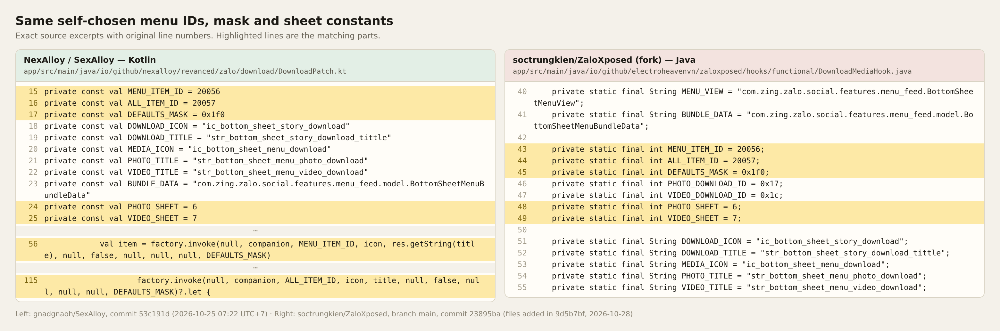

## 4. `FeedMedia`

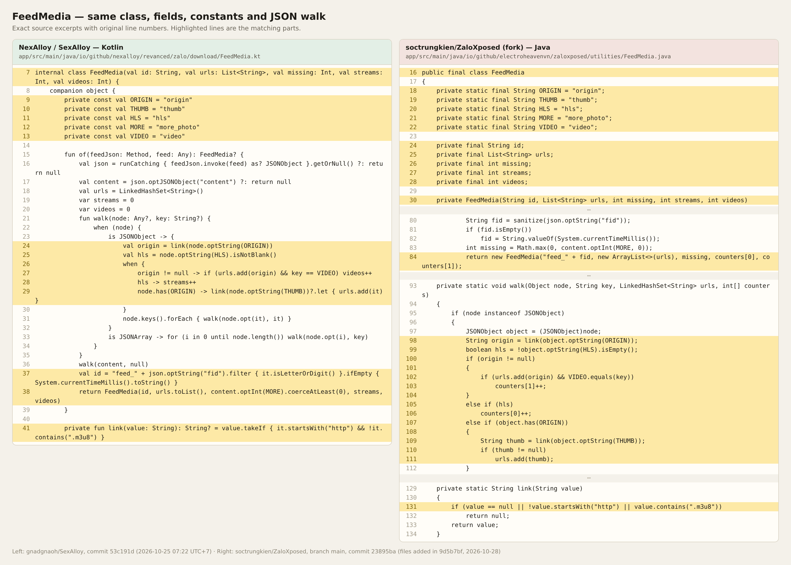

## 5. `ZaloModel`

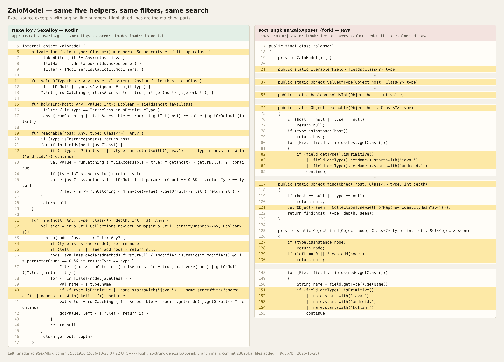

## 6. Saver and JXL handling

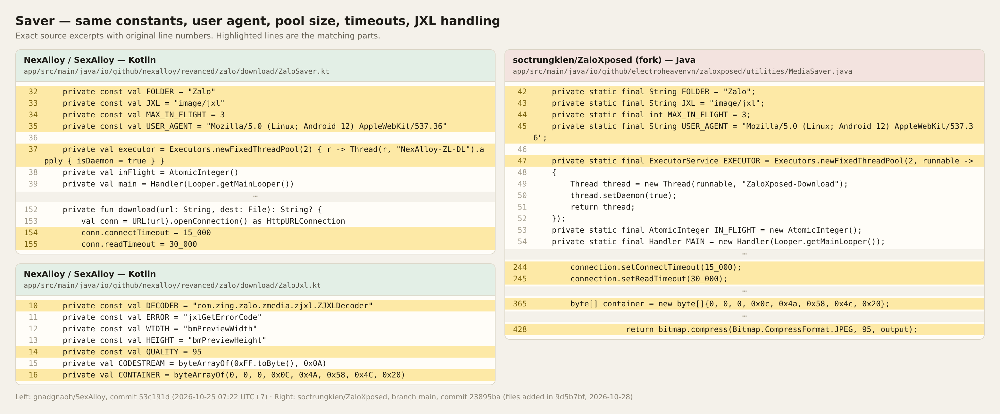

## 7. The feature was announced in the README, then the announcement was removed

Commit `9d5b7bf` (2026-10-28), the same commit that adds the four download files, also adds a "Media download" line to the feature list in `README.md`.

Two days later, commit [`128fc79`](https://github.com/soctrungkien/ZaloXposed/commit/128fc79c1ddb0cc42c1b192f3f8e84ef91bd99ba) (2026-10-30, message "hihi") deletes that line and restores the previous wording. That commit changes only `README.md` and `LiquidTabHook.java`. It does not touch the download code, and all four download files are still present at `23895ba`.

The result is a fork that ships the ported download feature while its README no longer mentions it.

Both commits are saved as patch files in [`docs/evidence/fork-commits/`](docs/evidence/fork-commits/), in case the fork's history is rewritten.

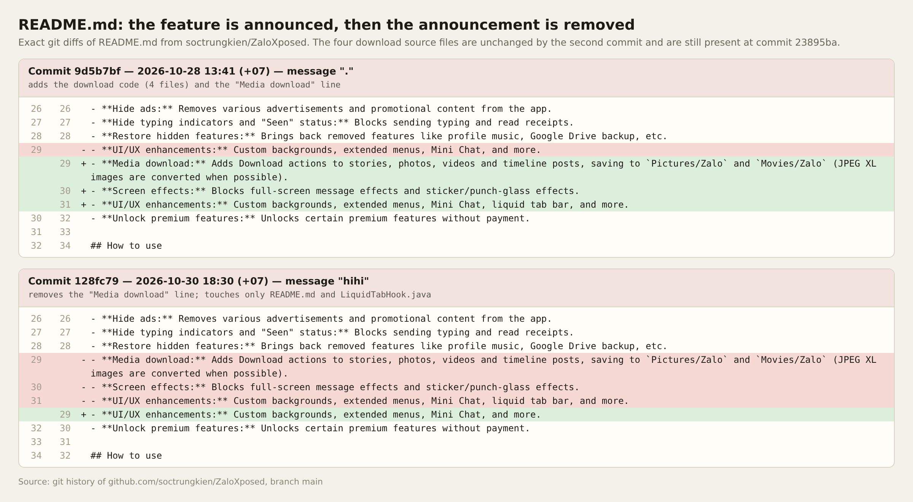

## 8. Timeline: the original came first

| When (UTC+7) | What | Who sets the time |
|---|---|---|
| 2026-10-25 00:19 | Screen recording of the working feature is created | file metadata |
| 2026-10-25 00:21 | Recording sent on Telegram | Telegram |
| 2026-10-25 00:29 | Test build `NexAlloy-zvideo-tt-1.apk` sent on Telegram | Telegram |
| **2026-10-25 07:17** | **Download patch committed to gnadgnaoh/SexAlloy (`19620f9`, `af04e0c`)** | **GitHub** |
| 2026-10-25 07:22 | Merged as pull request #50 (`53c191d`) | GitHub |
| **2026-10-28 13:41** | **Fork commit `9d5b7bf` adds the four ported files** | commit author |
| 2026-10-30 18:30 | Fork commit `128fc79` removes the "Media download" line from its README | commit author |
| 2026-11-12 03:12 UTC | This evidence is published (`3d1b1c2`), naming the comment and the IDs `20056` / `20057` | commit author |
| 2026-11-24 16:24 | Fork commit `bc4e4ae` re-adds the download files as "upstream feature diff", with the origin comment gone and the IDs renumbered | commit author |
| 2026-11-24 21:08 | Fork commit `aac4900`, the current `main` | commit author |
| 2026-11-24T14:10:33Z | Nightly APK built from `aac4900` published | GitHub |

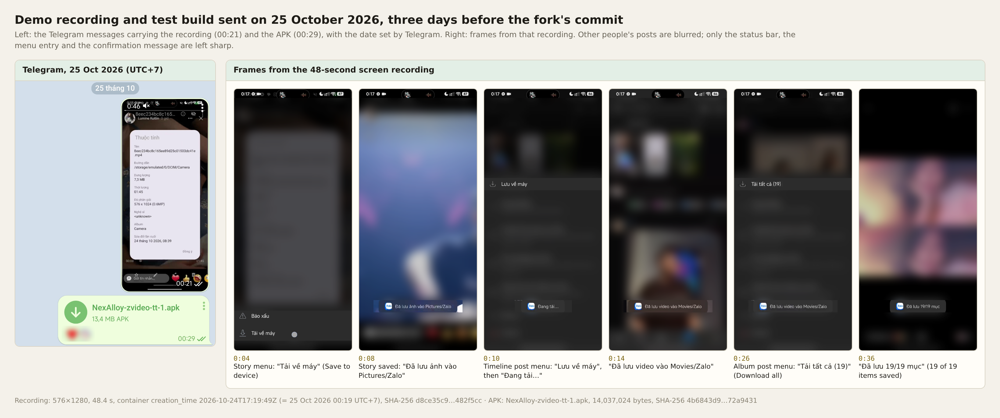

The original, unmodified recording is included: [`docs/evidence/demo-2026-10-25.mp4`](docs/evidence/demo-2026-10-25.mp4) (48 seconds, 13,638,784 bytes, SHA-256 `d8ce35c99be40e4c1d80438d6bd8a472bc9eb1b6b30ca0f897d401ce0482f5cc`). The frames in the image above are taken from it.

The recording shows the feature working: a save entry in the story menu, "Đã lưu ảnh vào Pictures/Zalo", "Đã lưu video vào Movies/Zalo", a "Tải tất cả (19)" (Download all) entry on an album post, and "Đã lưu 19/19 mục".

### What the 25 October test build contains

`NexAlloy-zvideo-tt-1.apk` (14,037,024 bytes, SHA-256 `4b6843d983560f4af99c83714910ab57640039d4cee092adbe6bae6e372a9431`) is an Xposed module (version `2.0.111`) whose scope includes `com.zing.zalo`. Its build metadata records the git revision it was built from, `e2244bbc5284653fe2f8a0a6761473b9d862cfbf`, a local commit that is not in the public repository. Its class names are minified, but the markers of the download patch are in its `classes.dex` and `resources.arsc`:

| Marker | In the 25 Oct APK | In the fork |
|---|---|---|
| Thread name `NexAlloy-ZL-DL` | yes | renamed to `ZaloXposed-Download` |
| `Mozilla/5.0 (Linux; Android 12) AppleWebKit/537.36` | yes | yes |
| `com.zing.zalo.zmedia.zjxl.ZJXLDecoder`, `jxlGetErrorCode`, `image/jxl` | yes | yes |
| `ic_bottom_sheet_story_download`, `str_bottom_sheet_story_download_tittle`, `str_bottom_sheet_menu_photo_download`, `str_bottom_sheet_menu_video_download` | yes | yes |
| `more_photo`, `feed_`, `zalo_story_` | yes | yes |
| Literals `20056` and `20057` in the bytecode | yes | yes (at `23895ba`; renumbered to `36701` / `36702` on 2026-11-24, see section 10) |
| String resources `zl_dl_*`, "Download all (%1$d)" | yes | hard-coded text instead |

The full, reproducible listing is in [`docs/evidence/apk-markers.txt`](docs/evidence/apk-markers.txt). It shows that the literal `20056` sits in the same method as `ic_bottom_sheet_story_download` and `str_bottom_sheet_story_download_tittle`, and `20057` in the same method as the photo and video download strings and `feed_`. The APK itself is not published; its hashes are in that file so that anyone holding a copy can verify it.

## 9. The fork matches the original as it was on 25 October

`dataStoryViewFull` is a string inside Zalo's own story-menu builder. The download patch searches for it to find the method where it inserts its Download entry; it belongs to the download patch and to no other feature.

On 25 October, `Fingerprints.kt` in SexAlloy (`53c191d`) searched for `dataStoryViewFull`. The 25 October test build contains the same string. SexAlloy later changed that lookup to `report_story_ad`, which is what the current `root` branch uses.

The fork searches for `dataStoryViewFull`, with the same shape of lookup: a method that returns `java.util.List` and uses that one string. So the fork reproduces the original exactly as it was published on 25 October, before the original changed.

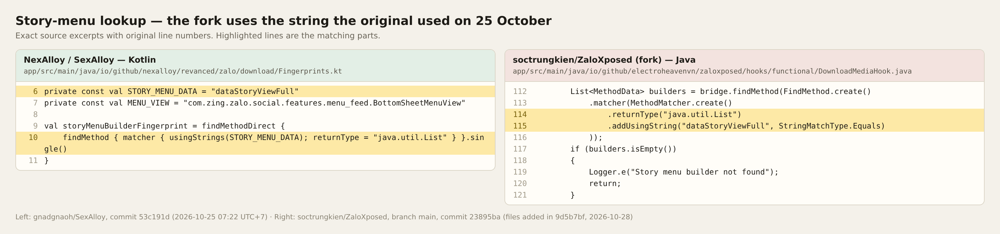


<a id="section-10"></a>
## 10. Update 2026-11-25: after rewriting its history, the fork still ships the same code

Checked on 2026-11-25. Fork HEAD: [`aac4900`](https://github.com/soctrungkien/ZaloXposed/tree/aac490026af6aa2bfbae00e133128fd20e9bac78) (`refs/heads/main` and `refs/tags/nightly`).

### 10.1 What changed in the fork

The fork's `main` branch has been replaced. The commits cited in sections 1–9 (`9d5b7bf`, `128fc79`, `23895ba`) are no longer on any branch. The new `main` is ElectroHeavenVN's upstream history up to `6806c9a` (2026-11-22), followed by five new commits dated 2026-11-24 by `soctrungkien <soctrungkien@hotmail.com>`. The earlier commits used the address `soctrungkien@github.com`. The new history was on GitHub no later than 2026-11-24T14:10:33Z, when the nightly APK built from its last commit was published (10.4).

The download code was re-added in the first of these, [`bc4e4ae`](https://github.com/soctrungkien/ZaloXposed/commit/bc4e4aea27062c8ca5be5acc52515955cf119709) (2026-11-24 16:24), with the message "Apply upstream feature diff and auto-fetch native libs from release APK". The file `DownloadMediaHook.java` was re-added already edited (10.3). It has not changed since, so `bc4e4ae` and `aac4900` hold the same content. Upstream [ElectroHeavenVN/ZaloXposed](https://github.com/ElectroHeavenVN/ZaloXposed) has none of the four download files on any of its branches (`main`, `dev`, `bilibili-theme`), checked 2026-11-25.

The old commits can still be fetched from GitHub by SHA, and their pages still load, for example [9d5b7bf](https://github.com/soctrungkien/ZaloXposed/commit/9d5b7bf13940e8eed299a6e00627e8965f34df79). GitHub shares git objects across a fork network, and this repository also contains them, so this shows that the commits still exist on GitHub. It does not show that they are stored only in the fork. Authorship is recorded in the commit objects themselves: author `soctrungkien`, 2026-10-28 13:41 +0700. The patches in `docs/evidence/fork-commits/` preserve them.

### 10.2 Three of the four files are byte-identical to the deleted commit

| File (under `app/src/main/java/io/github/electroheavenvn/zaloxposed/`) | Blob in `9d5b7bf` (2026-10-28) | Blob in `aac4900` (2026-11-24) | |
|---|---|---|---|
| `utilities/FeedMedia.java` | `a2ee28cce478` | `a2ee28cce478` | **identical** |
| `utilities/ZaloModel.java` | `26e6c8c1e179` | `26e6c8c1e179` | **identical** |
| `utilities/MediaSaver.java` | `1a2d162a81d4` | `1a2d162a81d4` | **identical** |
| `hooks/functional/DownloadMediaHook.java` | `3a46812eb2c8` | `bcc7a267b2c7` | edited (10.3) |

A git blob ID is the SHA-1 of the file content, so the same ID means the same bytes. Sections 4, 5 and 6, and images 03–05, therefore apply unchanged to the current fork.

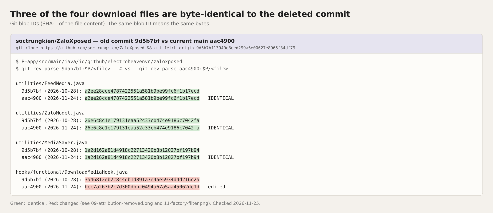

To reproduce:

```
git clone https://github.com/soctrungkien/ZaloXposed && cd ZaloXposed
OLD=9d5b7bf13940e8eed299a6e00627e8965f34df79; NEW=aac490026af6aa2bfbae00e133128fd20e9bac78
git fetch origin $OLD $NEW
P=app/src/main/java/io/github/electroheavenvn/zaloxposed
for f in utilities/FeedMedia.java utilities/ZaloModel.java utilities/MediaSaver.java hooks/functional/DownloadMediaHook.java; do
  echo "$f $(git rev-parse $OLD:$P/$f) $(git rev-parse $NEW:$P/$f)"; done
```

### 10.3 `DownloadMediaHook.java`: the origin comment was deleted and the invented menu IDs were renumbered

Two changes remove identifying marks:

- **The class comment of section 1 was deleted.** It said the implementation "is based on the readonly NexAlloy patch".
- **`20056` / `20057` became `36701` / `36702`.** Section 3 of this evidence, published 2026-11-12, identified these two numbers as invented by the original patch. Every other constant is unchanged: `DEFAULTS_MASK = 0x1f0`, `PHOTO_DOWNLOAD_ID = 0x17`, `VIDEO_DOWNLOAD_ID = 0x1c`, `PHOTO_SHEET = 6`, `VIDEO_SHEET = 7`, and all the resource-name constants.

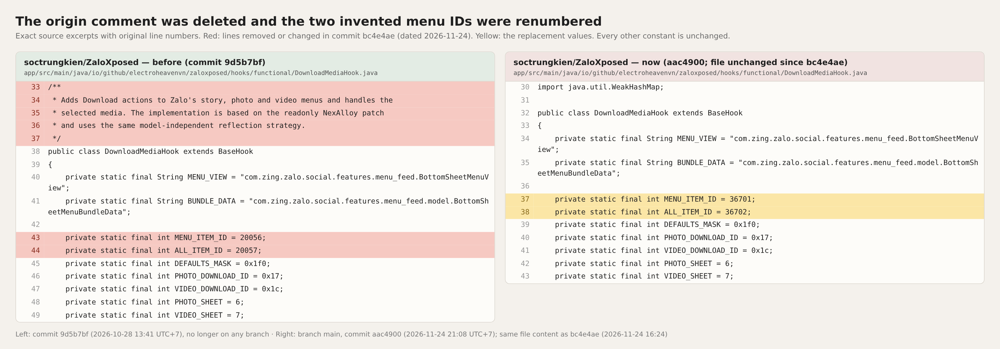

The rest of the diff, saved in full in [`docs/evidence/fork-commits/9d5b7bf-to-aac4900-DownloadMediaHook.diff`](docs/evidence/fork-commits/9d5b7bf-to-aac4900-DownloadMediaHook.diff), restructures the same logic:

- Inline loops were moved into helper methods: `findItemFactory`, `findCompanion`, `findPresenterGetter`, `firstField`, `addNativeItem`, `addFeedItem`, `newItem`, `hasInt`, `saveFeed`, `text`, `noMedia`, `resId`.
- `resolveStory()` was split into two methods.
- Two small differences besides: a cached `Context` field was added, and a `null` check on the story URL was dropped.

The lookups, matchers and strings are the same. Ignoring indentation, blank lines, lines holding only a brace, and comment lines, 223 of the 317 distinct code lines in the new file appear verbatim in the deleted version.

The new `findItemFactory` applies the same filter as `menuItemFactoryFingerprint` in the original `Fingerprints.kt`: a static method with 10 parameters, a non-void return type, a `Drawable` parameter, and de-duplication by descriptor. Line 177 carries the comment `// giữ hành vi cũ: lấy ứng viên cuối cùng` ("keep the old behaviour: take the last candidate").

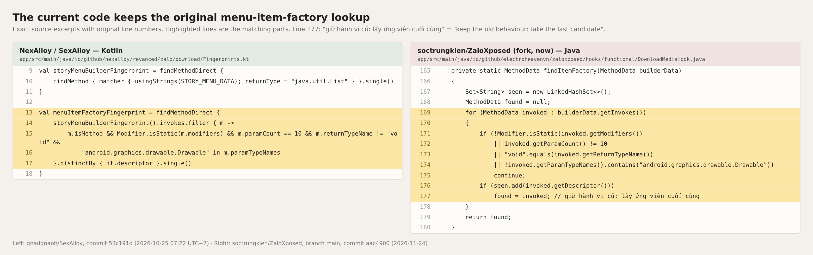

The story-menu lookup still uses `dataStoryViewFull` (line 116), so section 9 also holds for the current fork. The thread name is still `ZaloXposed-Download`.

### 10.4 The fork's published APK contains the code

The fork publishes [`ZaloXposed-app-release.apk`](https://github.com/soctrungkien/ZaloXposed/releases/download/nightly/ZaloXposed-app-release.apk) on its [`nightly` release](https://github.com/soctrungkien/ZaloXposed/releases/tag/nightly), listed at 2026-11-24T14:10:33Z. The APK's build metadata records revision `aac490026af6aa2bfbae00e133128fd20e9bac78`, the current `main`.

Its `classes.dex` is not obfuscated. It contains:

- the classes `DownloadMediaHook`, `FeedMedia`, `ZaloModel` and `MediaSaver`;
- the truncated `USER_AGENT` string;
- `ZJXLDecoder`, `dataStoryViewFull`, `ic_bottom_sheet_story_download`, `feed_` and `zalo_story_`;
- the literals `36701` and `36702` in `DownloadMediaHook`. `20056` / `20057` were not found, and `git grep -E '2005[67]' aac4900 -- app/` finds nothing in the source either.

Hashes and the full listing are in [`docs/evidence/nightly-apk-markers.txt`](docs/evidence/nightly-apk-markers.txt).

### 10.5 Attribution

The fork's own comment naming its source was removed. Its README credits libxposed, DexKit, smali and NPatch, but not NexAlloy or SexAlloy, and nothing says that the download code was modified from another project. SexAlloy is licensed under GPL-3.0.

### 10.6 Saved copies

- [`fork-commits/bc4e4ae-download-files.patch`](docs/evidence/fork-commits/bc4e4ae-download-files.patch): commit `bc4e4ae`, limited to the four download files.
- [`fork-commits/9d5b7bf-to-aac4900-DownloadMediaHook.diff`](docs/evidence/fork-commits/9d5b7bf-to-aac4900-DownloadMediaHook.diff): the full change to `DownloadMediaHook.java`.
- [`fork-commits/commit-objects-2026-11-24.txt`](docs/evidence/fork-commits/commit-objects-2026-11-24.txt): raw objects of the five commits of 2026-11-24.
- [`nightly-apk-markers.txt`](docs/evidence/nightly-apk-markers.txt): the published APK.

---

# Bằng chứng: code download Zalo trong soctrungkien/ZaloXposed được lấy từ SexAlloy

> **Cập nhật 25/11/2026:** trong các commit đề ngày 24/11/2026, fork đã thay lịch sử, xoá chú thích ghi nguồn và đổi số hai ID menu `20056` / `20057`. Ba trong bốn file download vẫn giống từng byte, và APK fork công bố vẫn chứa code này. Xem [mục 10](#muc-10). Các mục 1–9 bên dưới mô tả fork như ở `23895ba` và được giữ nguyên.

Tính năng tải media trong bản fork [soctrungkien/ZaloXposed](https://github.com/soctrungkien/ZaloXposed) là bản chuyển sang Java của patch **Download** cho Zalo trong [gnadgnaoh/SexAlloy](https://github.com/gnadgnaoh/SexAlloy) (package `io.github.nexalloy.revanced.zalo.download`).

Bản gốc được commit lên GitHub ngày **25/10/2026**. Fork thêm bản chuyển của mình ngày **28/10/2026**, ba ngày sau.

Mọi ảnh code đều là trích đoạn nguyên văn từ file nguồn, giữ đúng số dòng gốc. Không có dòng nào được gõ lại.

## Hai bên được so sánh

| | Repository | Commit | Thời điểm (UTC+7) |
|---|---|---|---|
| Bản gốc (Kotlin) | gnadgnaoh/SexAlloy | [`53c191d`](https://github.com/gnadgnaoh/SexAlloy/tree/53c191df7edb6cd637330d78297942a6c65f6a41/app/src/main/java/io/github/nexalloy/revanced/zalo/download) | 25/10/2026 07:22 |
| Bản chuyển (Java) | soctrungkien/ZaloXposed, nhánh `main` | `23895ba` (lịch sử cũ; `main` hiện tại là `aac4900`, xem mục 10) | 01/11/2026 12:34 |
| **Commit thêm code download được chuyển sang** | soctrungkien/ZaloXposed | **`9d5b7bf`** | **28/10/2026 13:41** |

Trong SexAlloy, sáu file download được thêm bởi commit `19620f9` ("Add download feature to stories and media menu", 07:17) và `af04e0c` ("Add download for Zalo (No Zalo Video)", 07:17), rồi được gộp bởi `53c191d` (pull request #50, 07:22). Cả ba đều được tạo trên trang web GitHub: người commit là `GitHub <noreply@github.com>` và chúng mang chữ ký tạo bằng khoá `B5690EEEBB952194`, khoá GitHub dùng cho các commit tạo qua giao diện web. Vì vậy thời điểm của chúng do máy chủ GitHub ghi. Nội dung thô của các commit, kèm chữ ký, được lưu trong [`docs/evidence/original-commits/`](docs/evidence/original-commits/).

Năm trong sáu file (`DownloadPatch.kt`, `FeedMedia.kt`, `ZaloModel.kt`, `ZaloSaver.kt`, `ZaloJxl.kt`) giống nhau từng byte giữa `53c191d` và nhánh `root` hiện tại. Chỉ `Fingerprints.kt` thay đổi về sau (xem mục 9).

Cả bốn file được chuyển sang đều được `soctrungkien` thêm vào fork trong cùng một commit: `9d5b7bf`, nội dung commit là ".".

Dự án gốc [ElectroHeavenVN/ZaloXposed](https://github.com/ElectroHeavenVN/ZaloXposed) không chứa các file này ở các nhánh `main`, `dev`, `microg` (kiểm tra ngày 12/11/2026). Bằng chứng này chỉ nói về bản fork.

## 1. Chính mã nguồn của fork ghi rõ nguồn gốc

Chú thích đầu class trong `hooks/functional/DownloadMediaHook.java`, dòng 34–36, viết rằng phần cài đặt "is based on the readonly NexAlloy patch and uses the same model-independent reflection strategy" (dựa trên patch NexAlloy và dùng cùng chiến lược reflection). Chú thích này có sẵn ngay từ commit `9d5b7bf`.

Dự án [NexAlloy/NexAlloy](https://github.com/NexAlloy/NexAlloy) gốc không có code Zalo nào. "Patch NexAlloy" duy nhất cho việc tải media Zalo là patch trong SexAlloy, vốn giữ tên package `io.github.nexalloy`.


## 2. Đối chiếu từng file

| SexAlloy (Kotlin) | soctrungkien/ZaloXposed (Java) | Điểm trùng |
|---|---|---|
| `DownloadPatch.kt`, `Fingerprints.kt` | `hooks/functional/DownloadMediaHook.java` | ID menu `20056` / `20057`, `DEFAULTS_MASK = 0x1f0`, `PHOTO_SHEET = 6`, `VIDEO_SHEET = 7`, cùng các hằng tên resource, cùng lời gọi factory tạo mục menu với 10 tham số |
| `FeedMedia.kt` | `utilities/FeedMedia.java` | Tên class, năm field `id, urls, missing, streams, videos`, năm hằng số, logic `walk` / `link`, tiền tố `"feed_"` |
| `ZaloModel.kt` | `utilities/ZaloModel.java` | Tên class, năm hàm `fields`, `valueOfType`, `holdsInt`, `reachable`, `find`, bộ lọc `java.` / `android.` / `kotlin.`, cách tìm theo độ sâu với tập identity |
| `ZaloSaver.kt`, `ZaloJxl.kt` | `utilities/MediaSaver.java` | `FOLDER`, `JXL`, `MAX_IN_FLIGHT = 3`, chuỗi `USER_AGENT` giống hệt, pool 2 thread, timeout 15 giây / 30 giây, chữ ký container JXL, chất lượng JPEG 95 |

## 3. ID menu và hằng số

`20056` và `20057` không phải giá trị của Zalo. Patch gốc tự đặt hai số này cho mục "Download" và "Download all" của riêng nó. Bản chuyển dùng đúng hai số đó và đúng các tên hằng đó.


## 4. `FeedMedia`


## 5. `ZaloModel`


## 6. Phần lưu file và xử lý JXL


## 7. Tính năng từng được ghi trong README, sau đó dòng ghi đó bị xoá

Commit `9d5b7bf` (28/10/2026), cũng là commit thêm bốn file download, có thêm dòng "Media download" vào danh sách tính năng trong `README.md`.

Hai ngày sau, commit [`128fc79`](https://github.com/soctrungkien/ZaloXposed/commit/128fc79c1ddb0cc42c1b192f3f8e84ef91bd99ba) (30/10/2026, nội dung "hihi") xoá dòng đó và trả lại câu chữ cũ. Commit này chỉ sửa `README.md` và `LiquidTabHook.java`. Nó không đụng tới code download, và cả bốn file download vẫn còn nguyên ở `23895ba`.

Kết quả là bản fork vẫn phát hành tính năng download được chuyển sang, trong khi README không còn nhắc tới nó.

Cả hai commit được lưu lại dưới dạng file patch trong [`docs/evidence/fork-commits/`](docs/evidence/fork-commits/), phòng khi lịch sử của fork bị viết lại.


## 8. Dòng thời gian: bản gốc có trước

| Thời điểm (UTC+7) | Sự việc | Ai ghi thời điểm |
|---|---|---|
| 25/10/2026 00:19 | Video quay màn hình tính năng đang chạy được tạo | metadata của file |
| 25/10/2026 00:21 | Video được gửi trên Telegram | Telegram |
| 25/10/2026 00:29 | Bản build thử `NexAlloy-zvideo-tt-1.apk` được gửi trên Telegram | Telegram |
| **25/10/2026 07:17** | **Patch download được commit vào gnadgnaoh/SexAlloy (`19620f9`, `af04e0c`)** | **GitHub** |
| 25/10/2026 07:22 | Được gộp qua pull request #50 (`53c191d`) | GitHub |
| **28/10/2026 13:41** | **Commit `9d5b7bf` của fork thêm bốn file được chuyển sang** | người commit |
| 30/10/2026 18:30 | Commit `128fc79` của fork xoá dòng "Media download" khỏi README | người commit |
| 12/11/2026 03:12 UTC | Bằng chứng này được công bố (`3d1b1c2`), chỉ ra chú thích ghi nguồn và hai ID `20056` / `20057` | người commit |
| 24/11/2026 16:24 | Commit `bc4e4ae` của fork thêm lại các file download với tên "upstream feature diff", chú thích ghi nguồn đã bị xoá và ID đã bị đổi số | người commit |
| 24/11/2026 21:08 | Commit `aac4900` của fork, tức `main` hiện tại | người commit |
| 2026-11-24T14:10:33Z | APK nightly build từ `aac4900` được công bố | GitHub |


Video gốc, không chỉnh sửa, được đính kèm: [`docs/evidence/demo-2026-10-25.mp4`](docs/evidence/demo-2026-10-25.mp4) (48 giây, 13.638.784 byte, SHA-256 `d8ce35c99be40e4c1d80438d6bd8a472bc9eb1b6b30ca0f897d401ce0482f5cc`). Các khung hình trong ảnh trên được lấy từ video này.

Video cho thấy tính năng đang chạy: mục lưu trong menu story, thông báo "Đã lưu ảnh vào Pictures/Zalo", "Đã lưu video vào Movies/Zalo", mục "Tải tất cả (19)" trên bài đăng album, và "Đã lưu 19/19 mục".

### Bản build thử ngày 25/10 chứa gì

`NexAlloy-zvideo-tt-1.apk` (14.037.024 byte, SHA-256 `4b6843d983560f4af99c83714910ab57640039d4cee092adbe6bae6e372a9431`) là một module Xposed (phiên bản `2.0.111`) có phạm vi gồm `com.zing.zalo`. Metadata của bản build ghi lại revision git mà nó được build từ đó, `e2244bbc5284653fe2f8a0a6761473b9d862cfbf`, một commit local không có trong repo công khai. Tên class đã bị rút gọn, nhưng các dấu hiệu của patch download nằm trong `classes.dex` và `resources.arsc`:

| Dấu hiệu | Trong APK 25/10 | Trong fork |
|---|---|---|
| Tên thread `NexAlloy-ZL-DL` | có | đổi thành `ZaloXposed-Download` |
| `Mozilla/5.0 (Linux; Android 12) AppleWebKit/537.36` | có | có |
| `com.zing.zalo.zmedia.zjxl.ZJXLDecoder`, `jxlGetErrorCode`, `image/jxl` | có | có |
| `ic_bottom_sheet_story_download`, `str_bottom_sheet_story_download_tittle`, `str_bottom_sheet_menu_photo_download`, `str_bottom_sheet_menu_video_download` | có | có |
| `more_photo`, `feed_`, `zalo_story_` | có | có |
| Hằng số `20056` và `20057` trong bytecode | có | có (ở `23895ba`; bị đổi thành `36701` / `36702` ngày 24/11/2026, xem mục 10) |
| Chuỗi resource `zl_dl_*`, "Download all (%1$d)" | có | thay bằng chữ viết cứng trong code |

Danh sách đầy đủ, có thể tự kiểm chứng lại, nằm trong [`docs/evidence/apk-markers.txt`](docs/evidence/apk-markers.txt). Nó cho thấy hằng số `20056` nằm cùng một hàm với `ic_bottom_sheet_story_download` và `str_bottom_sheet_story_download_tittle`, còn `20057` nằm cùng hàm với các chuỗi download ảnh, video và `feed_`. File APK không được công bố; mã băm của nó ghi trong file trên để ai có bản sao cũng đối chiếu được.

## 9. Fork khớp với bản gốc đúng như nó tồn tại ngày 25/10

`dataStoryViewFull` là một chuỗi nằm trong hàm dựng menu story của chính Zalo. Patch download tìm chuỗi này để xác định hàm mà nó chèn mục Download vào; nó thuộc patch download, không thuộc tính năng nào khác.

Ngày 25/10, `Fingerprints.kt` trong SexAlloy (`53c191d`) tìm chuỗi `dataStoryViewFull`. Bản build thử ngày 25/10 cũng chứa đúng chuỗi đó. Về sau SexAlloy đổi phép tìm này sang `report_story_ad`, là chuỗi nhánh `root` hiện tại đang dùng.

Fork tìm `dataStoryViewFull`, với cùng hình dạng phép tìm: một hàm trả về `java.util.List` và dùng đúng một chuỗi đó. Như vậy fork tái hiện bản gốc đúng như nó được công bố ngày 25/10, trước khi bản gốc thay đổi.


<a id="muc-10"></a>
## 10. Cập nhật 25/11/2026: sau khi viết lại lịch sử, fork vẫn phát hành đúng code đó

Kiểm tra ngày 25/11/2026. HEAD của fork: [`aac4900`](https://github.com/soctrungkien/ZaloXposed/tree/aac490026af6aa2bfbae00e133128fd20e9bac78) (`refs/heads/main` và `refs/tags/nightly`).

### 10.1 Fork đã thay đổi gì

Nhánh `main` của fork đã bị thay thế. Các commit được dẫn ở mục 1–9 (`9d5b7bf`, `128fc79`, `23895ba`) không còn nằm trên nhánh nào. Nhánh `main` mới là lịch sử của upstream ElectroHeavenVN đến `6806c9a` (22/11/2026), cộng thêm năm commit mới đề ngày 24/11/2026 của `soctrungkien <soctrungkien@hotmail.com>`. Các commit trước đây dùng địa chỉ `soctrungkien@github.com`. Lịch sử mới đã có trên GitHub muộn nhất là 2026-11-24T14:10:33Z, lúc APK nightly build từ commit cuối của nó được công bố (10.4).

Code download được thêm lại trong commit đầu tiên của nhóm này, [`bc4e4ae`](https://github.com/soctrungkien/ZaloXposed/commit/bc4e4aea27062c8ca5be5acc52515955cf119709) (24/11/2026 16:24), với nội dung commit "Apply upstream feature diff and auto-fetch native libs from release APK". File `DownloadMediaHook.java` được thêm lại ở dạng đã sửa sẵn (10.3). Nó không đổi từ đó, nên `bc4e4ae` và `aac4900` có cùng nội dung. Upstream [ElectroHeavenVN/ZaloXposed](https://github.com/ElectroHeavenVN/ZaloXposed) không có file nào trong bốn file download ở bất kỳ nhánh nào (`main`, `dev`, `bilibili-theme`), kiểm tra ngày 25/11/2026.

Các commit cũ vẫn lấy được từ GitHub theo SHA, và trang của chúng vẫn mở được, ví dụ [9d5b7bf](https://github.com/soctrungkien/ZaloXposed/commit/9d5b7bf13940e8eed299a6e00627e8965f34df79). GitHub dùng chung object git trong cả mạng fork, và repo này cũng chứa các commit đó. Vì vậy điều này cho thấy các commit vẫn còn trên GitHub, chứ không chứng minh chúng chỉ được lưu trong fork. Quyền tác giả được ghi trong chính các commit object: tác giả `soctrungkien`, 28/10/2026 13:41 +0700. Các file patch trong `docs/evidence/fork-commits/` lưu giữ chúng.

### 10.2 Ba trong bốn file giống từng byte với commit đã bị xoá

| File (trong `app/src/main/java/io/github/electroheavenvn/zaloxposed/`) | Blob ở `9d5b7bf` (28/10/2026) | Blob ở `aac4900` (24/11/2026) | |
|---|---|---|---|
| `utilities/FeedMedia.java` | `a2ee28cce478` | `a2ee28cce478` | **giống hệt** |
| `utilities/ZaloModel.java` | `26e6c8c1e179` | `26e6c8c1e179` | **giống hệt** |
| `utilities/MediaSaver.java` | `1a2d162a81d4` | `1a2d162a81d4` | **giống hệt** |
| `hooks/functional/DownloadMediaHook.java` | `3a46812eb2c8` | `bcc7a267b2c7` | đã sửa (10.3) |

Blob ID của git là mã SHA-1 của nội dung file, nên cùng ID nghĩa là cùng từng byte. Vì vậy các mục 4, 5, 6 và ảnh 03–05 vẫn đúng nguyên vẹn với fork hiện tại.


Cách tự kiểm chứng:

```
git clone https://github.com/soctrungkien/ZaloXposed && cd ZaloXposed
OLD=9d5b7bf13940e8eed299a6e00627e8965f34df79; NEW=aac490026af6aa2bfbae00e133128fd20e9bac78
git fetch origin $OLD $NEW
P=app/src/main/java/io/github/electroheavenvn/zaloxposed
for f in utilities/FeedMedia.java utilities/ZaloModel.java utilities/MediaSaver.java hooks/functional/DownloadMediaHook.java; do
  echo "$f $(git rev-parse $OLD:$P/$f) $(git rev-parse $NEW:$P/$f)"; done
```

### 10.3 `DownloadMediaHook.java`: chú thích ghi nguồn bị xoá, ID menu tự đặt bị đổi số

Hai thay đổi xoá dấu hiệu nhận diện:

- **Chú thích class ở mục 1 bị xoá.** Chú thích đó ghi rằng phần cài đặt "is based on the readonly NexAlloy patch".
- **`20056` / `20057` bị đổi thành `36701` / `36702`.** Mục 3 của bằng chứng này, công bố ngày 12/11/2026, đã chỉ ra hai số này do patch gốc tự đặt. Mọi hằng số khác giữ nguyên: `DEFAULTS_MASK = 0x1f0`, `PHOTO_DOWNLOAD_ID = 0x17`, `VIDEO_DOWNLOAD_ID = 0x1c`, `PHOTO_SHEET = 6`, `VIDEO_SHEET = 7`, và toàn bộ các hằng tên resource.


Phần còn lại của diff, lưu đầy đủ trong [`docs/evidence/fork-commits/9d5b7bf-to-aac4900-DownloadMediaHook.diff`](docs/evidence/fork-commits/9d5b7bf-to-aac4900-DownloadMediaHook.diff), sắp xếp lại cùng một logic:

- Các vòng lặp viết trực tiếp được tách ra thành hàm phụ: `findItemFactory`, `findCompanion`, `findPresenterGetter`, `firstField`, `addNativeItem`, `addFeedItem`, `newItem`, `hasInt`, `saveFeed`, `text`, `noMedia`, `resId`.
- `resolveStory()` được tách thành hai hàm.
- Ngoài ra có hai khác biệt nhỏ: thêm một trường lưu sẵn `Context`, và bỏ một phép kiểm tra `null` cho URL của story.

Các phép tìm, bộ lọc và chuỗi đều giữ nguyên. Bỏ qua thụt lề, dòng trống, dòng chỉ có dấu ngoặc nhọn và dòng chú thích, 223 trong 317 dòng code khác nhau của file mới xuất hiện nguyên văn trong phiên bản đã bị xoá.

Hàm `findItemFactory` mới dùng đúng bộ lọc của `menuItemFactoryFingerprint` trong `Fingerprints.kt` gốc: hàm static, 10 tham số, kiểu trả về khác void, có tham số `Drawable`, và loại trùng theo descriptor. Dòng 177 có chú thích `// giữ hành vi cũ: lấy ứng viên cuối cùng`.


Phép tìm menu story vẫn dùng `dataStoryViewFull` (dòng 116), nên mục 9 vẫn đúng với fork hiện tại. Tên thread vẫn là `ZaloXposed-Download`.

### 10.4 APK fork công bố có chứa code này

Fork công bố [`ZaloXposed-app-release.apk`](https://github.com/soctrungkien/ZaloXposed/releases/download/nightly/ZaloXposed-app-release.apk) trong [release `nightly`](https://github.com/soctrungkien/ZaloXposed/releases/tag/nightly), GitHub ghi thời điểm 2026-11-24T14:10:33Z. Metadata build của APK ghi revision `aac490026af6aa2bfbae00e133128fd20e9bac78`, tức `main` hiện tại.

`classes.dex` của APK không bị làm rối tên. Trong đó có:

- các class `DownloadMediaHook`, `FeedMedia`, `ZaloModel` và `MediaSaver`;
- chuỗi `USER_AGENT` bị cắt ngắn;
- `ZJXLDecoder`, `dataStoryViewFull`, `ic_bottom_sheet_story_download`, `feed_` và `zalo_story_`;
- hai hằng số `36701` và `36702` trong `DownloadMediaHook`. Không tìm thấy `20056` / `20057`, và `git grep -E '2005[67]' aac4900 -- app/` cũng không tìm thấy trong mã nguồn.

Mã băm và danh sách đầy đủ nằm trong [`docs/evidence/nightly-apk-markers.txt`](docs/evidence/nightly-apk-markers.txt).

### 10.5 Ghi nguồn

Chú thích tự ghi nguồn của chính fork đã bị xoá. README của fork ghi công libxposed, DexKit, smali và NPatch, nhưng không nhắc NexAlloy hay SexAlloy, và không có chỗ nào nói code download được sửa từ một dự án khác. SexAlloy được cấp phép theo GPL-3.0.

### 10.6 Bản lưu

- [`fork-commits/bc4e4ae-download-files.patch`](docs/evidence/fork-commits/bc4e4ae-download-files.patch): commit `bc4e4ae`, chỉ gồm bốn file download.
- [`fork-commits/9d5b7bf-to-aac4900-DownloadMediaHook.diff`](docs/evidence/fork-commits/9d5b7bf-to-aac4900-DownloadMediaHook.diff): toàn bộ thay đổi của `DownloadMediaHook.java`.
- [`fork-commits/commit-objects-2026-11-24.txt`](docs/evidence/fork-commits/commit-objects-2026-11-24.txt): nội dung thô của năm commit ngày 24/11/2026.
- [`nightly-apk-markers.txt`](docs/evidence/nightly-apk-markers.txt): APK đã công bố.
