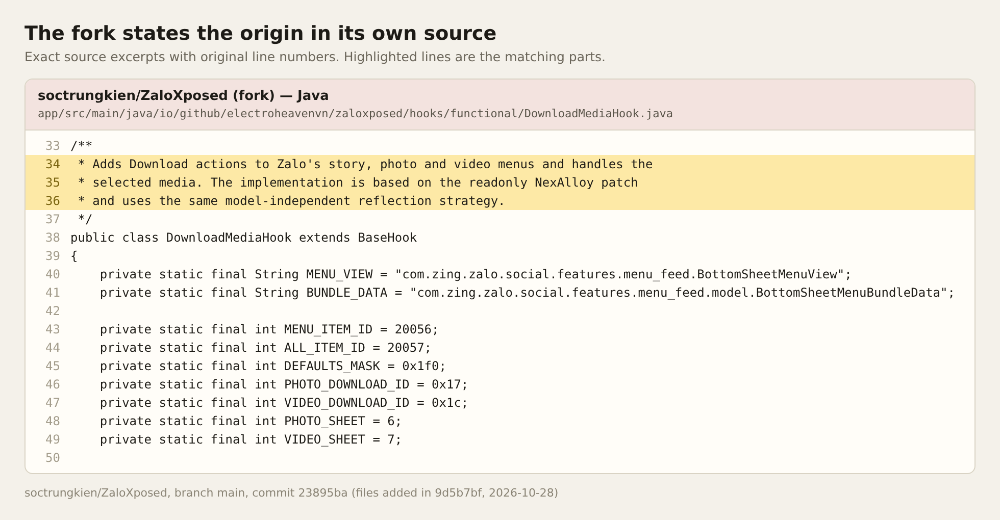
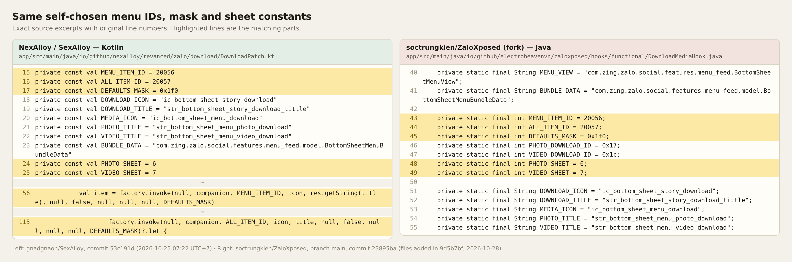
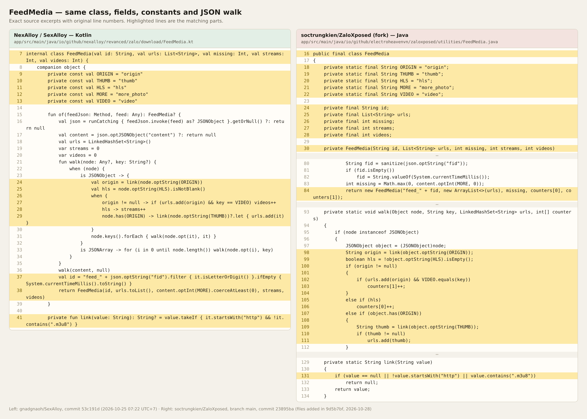
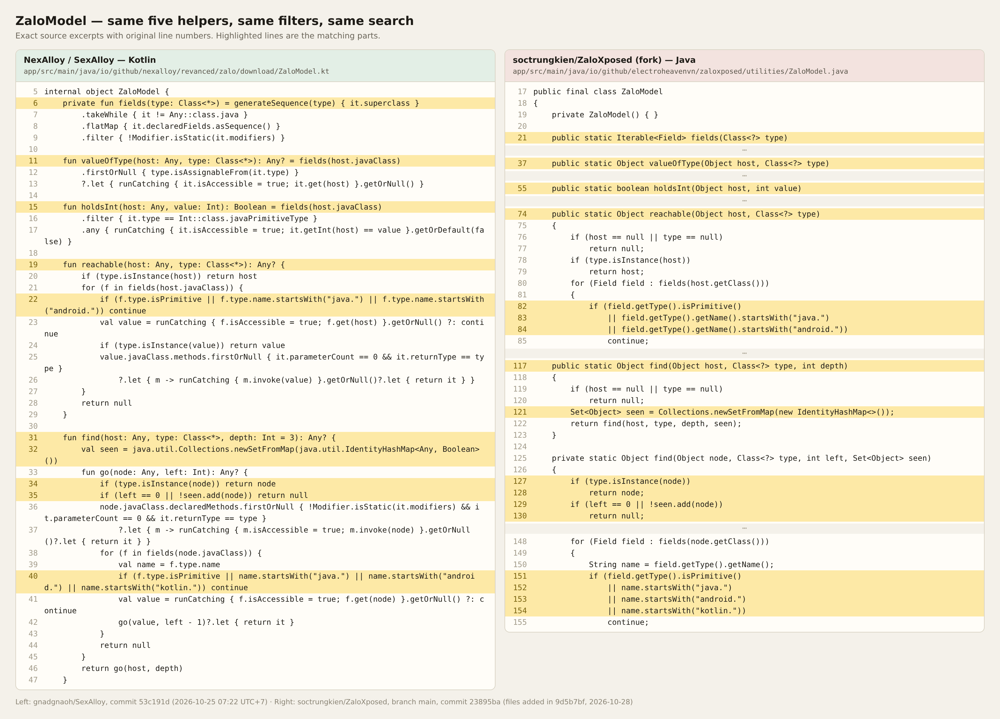
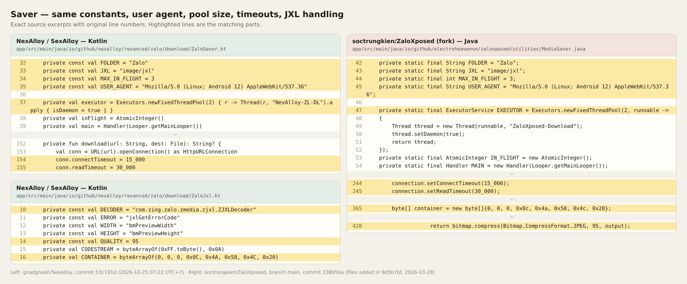
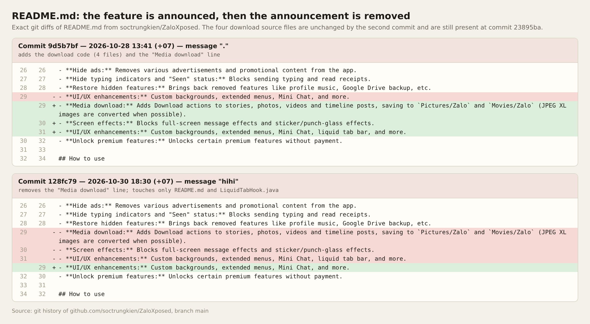
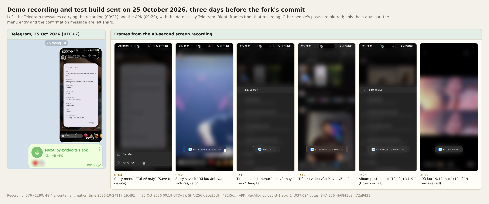
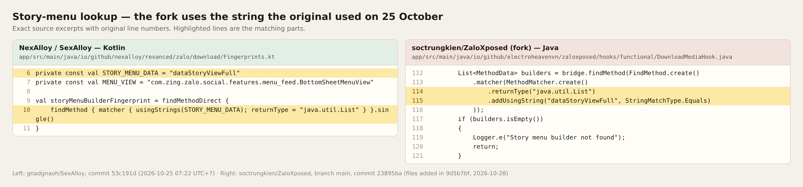

# Evidence: the Zalo download code in soctrungkien/ZaloXposed is taken from SexAlloy

The media download feature in the fork [soctrungkien/ZaloXposed](https://github.com/soctrungkien/ZaloXposed) is a Java port of the Zalo **Download** patch from [gnadgnaoh/SexAlloy](https://github.com/gnadgnaoh/SexAlloy) (package `io.github.nexalloy.revanced.zalo.download`).

The original was committed on GitHub on **25 October 2026**. The fork added its port on **28 October 2026**, three days later.

Every code image is an exact excerpt of the source files with their original line numbers. Nothing is retyped.

## What was compared

| | Repository | Commit | Date (UTC+7) |
|---|---|---|---|
| Original (Kotlin) | gnadgnaoh/SexAlloy | [`53c191d`](https://github.com/gnadgnaoh/SexAlloy/tree/53c191df7edb6cd637330d78297942a6c65f6a41/app/src/main/java/io/github/nexalloy/revanced/zalo/download) | 2026-10-25 07:22 |
| Port (Java) | soctrungkien/ZaloXposed, branch `main` | `23895ba` | 2026-11-01 12:34 |
| **Commit that added the ported download code** | soctrungkien/ZaloXposed | **`9d5b7bf`** | **2026-10-28 13:41** |

In SexAlloy, the six download files were added by commits `19620f9` ("Add download feature to stories and media menu", 07:17) and `af04e0c` ("Add download for Zalo (No Zalo Video)", 07:17), then merged by `53c191d` (pull request #50, 07:22). All three were created on the GitHub website: their committer is `GitHub <noreply@github.com>` and they carry a signature made with key `B5690EEEBB952194`, the key GitHub uses for commits made through its web interface. Their timestamps therefore come from GitHub's servers. The raw commit objects, signatures included, are saved in [`docs/evidence/original-commits/`](docs/evidence/original-commits/).

Five of the six files (`DownloadPatch.kt`, `FeedMedia.kt`, `ZaloModel.kt`, `ZaloSaver.kt`, `ZaloJxl.kt`) are byte-identical between `53c191d` and the current `root` branch. Only `Fingerprints.kt` changed afterwards (see section 9).

All four ported files were added to the fork in one commit by `soctrungkien`: `9d5b7bf`, with the commit message ".".

The upstream project [ElectroHeavenVN/ZaloXposed](https://github.com/ElectroHeavenVN/ZaloXposed) does not contain these files in its `main`, `dev` or `microg` branches (checked 2026-11-12). This evidence concerns the fork only.

## 1. The fork's own source names the origin

The class comment of `hooks/functional/DownloadMediaHook.java`, lines 34–36, says the implementation "is based on the readonly NexAlloy patch and uses the same model-independent reflection strategy". The comment is already present in commit `9d5b7bf`.

Upstream [NexAlloy/NexAlloy](https://github.com/NexAlloy/NexAlloy) has no Zalo code. The only "NexAlloy patch" for Zalo download is the one in SexAlloy, which keeps the `io.github.nexalloy` package name.

## 2. File-by-file mapping

| SexAlloy (Kotlin) | soctrungkien/ZaloXposed (Java) | What matches |
|---|---|---|
| `DownloadPatch.kt`, `Fingerprints.kt` | `hooks/functional/DownloadMediaHook.java` | Menu IDs `20056` / `20057`, `DEFAULTS_MASK = 0x1f0`, `PHOTO_SHEET = 6`, `VIDEO_SHEET = 7`, the same resource-name constants, the same 10-argument menu-item factory call |
| `FeedMedia.kt` | `utilities/FeedMedia.java` | Class name, the five fields `id, urls, missing, streams, videos`, the five constants, the `walk` / `link` logic, the `"feed_"` prefix |
| `ZaloModel.kt` | `utilities/ZaloModel.java` | Class name, the five helpers `fields`, `valueOfType`, `holdsInt`, `reachable`, `find`, the `java.` / `android.` / `kotlin.` filters, the identity-set depth search |
| `ZaloSaver.kt`, `ZaloJxl.kt` | `utilities/MediaSaver.java` | `FOLDER`, `JXL`, `MAX_IN_FLIGHT = 3`, the identical `USER_AGENT` string, a 2-thread pool, 15 s / 30 s timeouts, the JXL container signature, JPEG quality 95 |

## 3. Menu IDs and constants

`20056` and `20057` are not Zalo values. The original patch invented them for its own "Download" and "Download all" menu entries. The same numbers and the same constant names appear in the port.

## 4. `FeedMedia`

## 5. `ZaloModel`

## 6. Saver and JXL handling

## 7. The feature was announced in the README, then the announcement was removed

Commit `9d5b7bf` (2026-10-28), the same commit that adds the four download files, also adds a "Media download" line to the feature list in `README.md`.

Two days later, commit [`128fc79`](https://github.com/soctrungkien/ZaloXposed/commit/128fc79c1ddb0cc42c1b192f3f8e84ef91bd99ba) (2026-10-30, message "hihi") deletes that line and restores the previous wording. That commit changes only `README.md` and `LiquidTabHook.java`. It does not touch the download code, and all four download files are still present at `23895ba`.

The result is a fork that ships the ported download feature while its README no longer mentions it.

Both commits are saved as patch files in [`docs/evidence/fork-commits/`](docs/evidence/fork-commits/), in case the fork's history is rewritten.

## 8. Timeline: the original came first

| When (UTC+7) | What | Who sets the time |
|---|---|---|
| 2026-10-25 00:19 | Screen recording of the working feature is created | file metadata |
| 2026-10-25 00:21 | Recording sent on Telegram | Telegram |
| 2026-10-25 00:29 | Test build `NexAlloy-zvideo-tt-1.apk` sent on Telegram | Telegram |
| **2026-10-25 07:17** | **Download patch committed to gnadgnaoh/SexAlloy (`19620f9`, `af04e0c`)** | **GitHub** |
| 2026-10-25 07:22 | Merged as pull request #50 (`53c191d`) | GitHub |
| **2026-10-28 13:41** | **Fork commit `9d5b7bf` adds the four ported files** | commit author |
| 2026-10-30 18:30 | Fork commit `128fc79` removes the "Media download" line from its README | commit author |

The original, unmodified recording is included: [`docs/evidence/demo-2026-10-25.mp4`](docs/evidence/demo-2026-10-25.mp4) (48 seconds, 13,638,784 bytes, SHA-256 `d8ce35c99be40e4c1d80438d6bd8a472bc9eb1b6b30ca0f897d401ce0482f5cc`). The frames in the image above are taken from it.

The recording shows the feature working: a save entry in the story menu, "Đã lưu ảnh vào Pictures/Zalo", "Đã lưu video vào Movies/Zalo", a "Tải tất cả (19)" (Download all) entry on an album post, and "Đã lưu 19/19 mục".

### What the 25 October test build contains

`NexAlloy-zvideo-tt-1.apk` (14,037,024 bytes, SHA-256 `4b6843d983560f4af99c83714910ab57640039d4cee092adbe6bae6e372a9431`) is an Xposed module (version `2.0.111`) whose scope includes `com.zing.zalo`. Its build metadata records the git revision it was built from, `e2244bbc5284653fe2f8a0a6761473b9d862cfbf`, a local commit that is not in the public repository. Its class names are minified, but the markers of the download patch are in its `classes.dex` and `resources.arsc`:

| Marker | In the 25 Oct APK | In the fork |
|---|---|---|
| Thread name `NexAlloy-ZL-DL` | yes | renamed to `ZaloXposed-Download` |
| `Mozilla/5.0 (Linux; Android 12) AppleWebKit/537.36` | yes | yes |
| `com.zing.zalo.zmedia.zjxl.ZJXLDecoder`, `jxlGetErrorCode`, `image/jxl` | yes | yes |
| `ic_bottom_sheet_story_download`, `str_bottom_sheet_story_download_tittle`, `str_bottom_sheet_menu_photo_download`, `str_bottom_sheet_menu_video_download` | yes | yes |
| `more_photo`, `feed_`, `zalo_story_` | yes | yes |
| Literals `20056` and `20057` in the bytecode | yes | yes |
| String resources `zl_dl_*`, "Download all (%1$d)" | yes | hard-coded text instead |

The full, reproducible listing is in [`docs/evidence/apk-markers.txt`](docs/evidence/apk-markers.txt). It shows that the literal `20056` sits in the same method as `ic_bottom_sheet_story_download` and `str_bottom_sheet_story_download_tittle`, and `20057` in the same method as the photo and video download strings and `feed_`. The APK itself is not published; its hashes are in that file so that anyone holding a copy can verify it.

## 9. The fork matches the original as it was on 25 October

`dataStoryViewFull` is a string inside Zalo's own story-menu builder. The download patch searches for it to find the method where it inserts its Download entry; it belongs to the download patch and to no other feature.

On 25 October, `Fingerprints.kt` in SexAlloy (`53c191d`) searched for `dataStoryViewFull`. The 25 October test build contains the same string. SexAlloy later changed that lookup to `report_story_ad`, which is what the current `root` branch uses.

The fork searches for `dataStoryViewFull`, with the same shape of lookup: a method that returns `java.util.List` and uses that one string. So the fork reproduces the original exactly as it was published on 25 October, before the original changed.

---

# Bằng chứng: code download Zalo trong soctrungkien/ZaloXposed được lấy từ SexAlloy

Tính năng tải media trong bản fork [soctrungkien/ZaloXposed](https://github.com/soctrungkien/ZaloXposed) là bản chuyển sang Java của patch **Download** cho Zalo trong [gnadgnaoh/SexAlloy](https://github.com/gnadgnaoh/SexAlloy) (package `io.github.nexalloy.revanced.zalo.download`).

Bản gốc được commit lên GitHub ngày **25/10/2026**. Fork thêm bản chuyển của mình ngày **28/10/2026**, ba ngày sau.

Mọi ảnh code đều là trích đoạn nguyên văn từ file nguồn, giữ đúng số dòng gốc. Không có dòng nào được gõ lại.

## Hai bên được so sánh

| | Repository | Commit | Thời điểm (UTC+7) |
|---|---|---|---|
| Bản gốc (Kotlin) | gnadgnaoh/SexAlloy | [`53c191d`](https://github.com/gnadgnaoh/SexAlloy/tree/53c191df7edb6cd637330d78297942a6c65f6a41/app/src/main/java/io/github/nexalloy/revanced/zalo/download) | 25/10/2026 07:22 |
| Bản chuyển (Java) | soctrungkien/ZaloXposed, nhánh `main` | `23895ba` | 01/11/2026 12:34 |
| **Commit thêm code download được chuyển sang** | soctrungkien/ZaloXposed | **`9d5b7bf`** | **28/10/2026 13:41** |

Trong SexAlloy, sáu file download được thêm bởi commit `19620f9` ("Add download feature to stories and media menu", 07:17) và `af04e0c` ("Add download for Zalo (No Zalo Video)", 07:17), rồi được gộp bởi `53c191d` (pull request #50, 07:22). Cả ba đều được tạo trên trang web GitHub: người commit là `GitHub <noreply@github.com>` và chúng mang chữ ký tạo bằng khoá `B5690EEEBB952194`, khoá GitHub dùng cho các commit tạo qua giao diện web. Vì vậy thời điểm của chúng do máy chủ GitHub ghi. Nội dung thô của các commit, kèm chữ ký, được lưu trong [`docs/evidence/original-commits/`](docs/evidence/original-commits/).

Năm trong sáu file (`DownloadPatch.kt`, `FeedMedia.kt`, `ZaloModel.kt`, `ZaloSaver.kt`, `ZaloJxl.kt`) giống nhau từng byte giữa `53c191d` và nhánh `root` hiện tại. Chỉ `Fingerprints.kt` thay đổi về sau (xem mục 9).

Cả bốn file được chuyển sang đều được `soctrungkien` thêm vào fork trong cùng một commit: `9d5b7bf`, nội dung commit là ".".

Dự án gốc [ElectroHeavenVN/ZaloXposed](https://github.com/ElectroHeavenVN/ZaloXposed) không chứa các file này ở các nhánh `main`, `dev`, `microg` (kiểm tra ngày 12/11/2026). Bằng chứng này chỉ nói về bản fork.

## 1. Chính mã nguồn của fork ghi rõ nguồn gốc

Chú thích đầu class trong `hooks/functional/DownloadMediaHook.java`, dòng 34–36, viết rằng phần cài đặt "is based on the readonly NexAlloy patch and uses the same model-independent reflection strategy" (dựa trên patch NexAlloy và dùng cùng chiến lược reflection). Chú thích này có sẵn ngay từ commit `9d5b7bf`.

Dự án [NexAlloy/NexAlloy](https://github.com/NexAlloy/NexAlloy) gốc không có code Zalo nào. "Patch NexAlloy" duy nhất cho việc tải media Zalo là patch trong SexAlloy, vốn giữ tên package `io.github.nexalloy`.

## 2. Đối chiếu từng file

| SexAlloy (Kotlin) | soctrungkien/ZaloXposed (Java) | Điểm trùng |
|---|---|---|
| `DownloadPatch.kt`, `Fingerprints.kt` | `hooks/functional/DownloadMediaHook.java` | ID menu `20056` / `20057`, `DEFAULTS_MASK = 0x1f0`, `PHOTO_SHEET = 6`, `VIDEO_SHEET = 7`, cùng các hằng tên resource, cùng lời gọi factory tạo mục menu với 10 tham số |
| `FeedMedia.kt` | `utilities/FeedMedia.java` | Tên class, năm field `id, urls, missing, streams, videos`, năm hằng số, logic `walk` / `link`, tiền tố `"feed_"` |
| `ZaloModel.kt` | `utilities/ZaloModel.java` | Tên class, năm hàm `fields`, `valueOfType`, `holdsInt`, `reachable`, `find`, bộ lọc `java.` / `android.` / `kotlin.`, cách tìm theo độ sâu với tập identity |
| `ZaloSaver.kt`, `ZaloJxl.kt` | `utilities/MediaSaver.java` | `FOLDER`, `JXL`, `MAX_IN_FLIGHT = 3`, chuỗi `USER_AGENT` giống hệt, pool 2 thread, timeout 15 giây / 30 giây, chữ ký container JXL, chất lượng JPEG 95 |

## 3. ID menu và hằng số

`20056` và `20057` không phải giá trị của Zalo. Patch gốc tự đặt hai số này cho mục "Download" và "Download all" của riêng nó. Bản chuyển dùng đúng hai số đó và đúng các tên hằng đó.

## 4. `FeedMedia`

## 5. `ZaloModel`

## 6. Phần lưu file và xử lý JXL

## 7. Tính năng từng được ghi trong README, sau đó dòng ghi đó bị xoá

Commit `9d5b7bf` (28/10/2026), cũng là commit thêm bốn file download, có thêm dòng "Media download" vào danh sách tính năng trong `README.md`.

Hai ngày sau, commit [`128fc79`](https://github.com/soctrungkien/ZaloXposed/commit/128fc79c1ddb0cc42c1b192f3f8e84ef91bd99ba) (30/10/2026, nội dung "hihi") xoá dòng đó và trả lại câu chữ cũ. Commit này chỉ sửa `README.md` và `LiquidTabHook.java`. Nó không đụng tới code download, và cả bốn file download vẫn còn nguyên ở `23895ba`.

Kết quả là bản fork vẫn phát hành tính năng download được chuyển sang, trong khi README không còn nhắc tới nó.

Cả hai commit được lưu lại dưới dạng file patch trong [`docs/evidence/fork-commits/`](docs/evidence/fork-commits/), phòng khi lịch sử của fork bị viết lại.

## 8. Dòng thời gian: bản gốc có trước

| Thời điểm (UTC+7) | Sự việc | Ai ghi thời điểm |
|---|---|---|
| 25/10/2026 00:19 | Video quay màn hình tính năng đang chạy được tạo | metadata của file |
| 25/10/2026 00:21 | Video được gửi trên Telegram | Telegram |
| 25/10/2026 00:29 | Bản build thử `NexAlloy-zvideo-tt-1.apk` được gửi trên Telegram | Telegram |
| **25/10/2026 07:17** | **Patch download được commit vào gnadgnaoh/SexAlloy (`19620f9`, `af04e0c`)** | **GitHub** |
| 25/10/2026 07:22 | Được gộp qua pull request #50 (`53c191d`) | GitHub |
| **28/10/2026 13:41** | **Commit `9d5b7bf` của fork thêm bốn file được chuyển sang** | người commit |
| 30/10/2026 18:30 | Commit `128fc79` của fork xoá dòng "Media download" khỏi README | người commit |

Video gốc, không chỉnh sửa, được đính kèm: [`docs/evidence/demo-2026-10-25.mp4`](docs/evidence/demo-2026-10-25.mp4) (48 giây, 13.638.784 byte, SHA-256 `d8ce35c99be40e4c1d80438d6bd8a472bc9eb1b6b30ca0f897d401ce0482f5cc`). Các khung hình trong ảnh trên được lấy từ video này.

Video cho thấy tính năng đang chạy: mục lưu trong menu story, thông báo "Đã lưu ảnh vào Pictures/Zalo", "Đã lưu video vào Movies/Zalo", mục "Tải tất cả (19)" trên bài đăng album, và "Đã lưu 19/19 mục".

### Bản build thử ngày 25/10 chứa gì

`NexAlloy-zvideo-tt-1.apk` (14.037.024 byte, SHA-256 `4b6843d983560f4af99c83714910ab57640039d4cee092adbe6bae6e372a9431`) là một module Xposed (phiên bản `2.0.111`) có phạm vi gồm `com.zing.zalo`. Metadata của bản build ghi lại revision git mà nó được build từ đó, `e2244bbc5284653fe2f8a0a6761473b9d862cfbf`, một commit local không có trong repo công khai. Tên class đã bị rút gọn, nhưng các dấu hiệu của patch download nằm trong `classes.dex` và `resources.arsc`:

| Dấu hiệu | Trong APK 25/10 | Trong fork |
|---|---|---|
| Tên thread `NexAlloy-ZL-DL` | có | đổi thành `ZaloXposed-Download` |
| `Mozilla/5.0 (Linux; Android 12) AppleWebKit/537.36` | có | có |
| `com.zing.zalo.zmedia.zjxl.ZJXLDecoder`, `jxlGetErrorCode`, `image/jxl` | có | có |
| `ic_bottom_sheet_story_download`, `str_bottom_sheet_story_download_tittle`, `str_bottom_sheet_menu_photo_download`, `str_bottom_sheet_menu_video_download` | có | có |
| `more_photo`, `feed_`, `zalo_story_` | có | có |
| Hằng số `20056` và `20057` trong bytecode | có | có |
| Chuỗi resource `zl_dl_*`, "Download all (%1$d)" | có | thay bằng chữ viết cứng trong code |

Danh sách đầy đủ, có thể tự kiểm chứng lại, nằm trong [`docs/evidence/apk-markers.txt`](docs/evidence/apk-markers.txt). Nó cho thấy hằng số `20056` nằm cùng một hàm với `ic_bottom_sheet_story_download` và `str_bottom_sheet_story_download_tittle`, còn `20057` nằm cùng hàm với các chuỗi download ảnh, video và `feed_`. File APK không được công bố; mã băm của nó ghi trong file trên để ai có bản sao cũng đối chiếu được.

## 9. Fork khớp với bản gốc đúng như nó tồn tại ngày 25/10

`dataStoryViewFull` là một chuỗi nằm trong hàm dựng menu story của chính Zalo. Patch download tìm chuỗi này để xác định hàm mà nó chèn mục Download vào; nó thuộc patch download, không thuộc tính năng nào khác.

Ngày 25/10, `Fingerprints.kt` trong SexAlloy (`53c191d`) tìm chuỗi `dataStoryViewFull`. Bản build thử ngày 25/10 cũng chứa đúng chuỗi đó. Về sau SexAlloy đổi phép tìm này sang `report_story_ad`, là chuỗi nhánh `root` hiện tại đang dùng.

Fork tìm `dataStoryViewFull`, với cùng hình dạng phép tìm: một hàm trả về `java.util.List` và dùng đúng một chuỗi đó. Như vậy fork tái hiện bản gốc đúng như nó được công bố ngày 25/10, trước khi bản gốc thay đổi.

